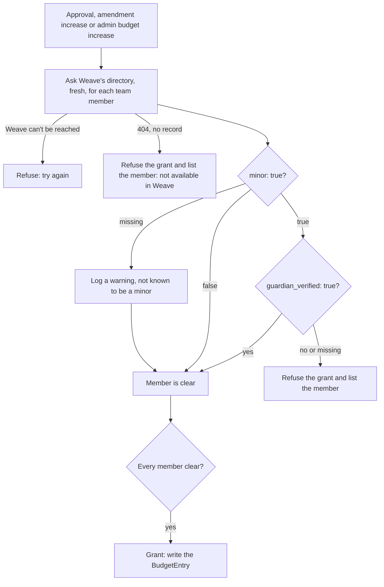

# Krater — Project Ganymede Approval & Compute Allocation Portal

Revised Sep 26, 2026. Supersedes the Sep 24 draft (drafted with @Adam). Roles live in Weave (maintainer decision,
Oct 7, 2026; see "Roles & authentication").
The previous draft was checked against the Weave codebase and the SkyPilot docs and source. This revision fixes the
places where it assumed capabilities that don't exist. On 2026-10-11 SkyPilot was dropped for Krater Compute, Krater's
own layer on Vast.ai (SkyPilot's Vast support couldn't rent a machine, copied the organization's Vast key onto
members' hosts and ignored the hourly cap). The integration details are in
[weave-integration.md](weave-integration.md), [compute/](compute/README.md) and
[quilt-integration.md](quilt-integration.md).

## What changed from the Sep 24 draft

| Area | Sep 24 draft | This revision | Why |
| --- | --- | --- | --- |
| Budget enforcement | Handed to "SkyPilot's internal budgeting" | **Krater rents the machines and enforces it** (Krater Compute, since 2026-10-11) | SkyPilot had no dollar budgets, and its Vast support couldn't be fixed from outside |
| Reviewer role | "A claim Krater reads from Weave" | **Weave owns roles** as app-defined roles on Krater's Weave app, sent in a `roles` claim and re-checked through Weave's directory API | Weave's original claims had no roles; the Weave work adds app roles and a directory API |
| Slack membership | "Weave users are already Slack members" | **Only full Slack members can submit**, checked with Weave's `slack_member`, else with Slack itself | Weave signup is open, new users are single-channel guests, and some never join Slack |
| Reviews | Attached to the project | Attached to a **project revision** | Otherwise approvals of an old version count toward a resubmitted one |
| Amendments | Approved → back through review | Approved project **stays approved** while an amendment revision is reviewed | Otherwise compute is cut off during review |
| Budget | `budget_approved` column + `BudgetReclaim` table | **Append-only budget ledger** | One place for the ceiling and for the audit trail |
| Comments | Mirrored from Slack into Krater's DB | **Not mirrored in v1**; Krater links to the channel | Mirroring means handling Slack edits, deletes and threads, for little gain |
| Deployment | "Two containers" | Portal, worker, Postgres, S3 storage | That's what it actually takes |

## Overview & scope

**Krater** is the web portal for Project Ganymede (Patchwork Labs). It does three things:

1. Reviews and approves member-submitted project proposals.
2. Allocates a dollar-denominated compute budget to approved projects, runs members' jobs and boxes on Vast.ai
   within it, and **enforces** it.
3. Hosts a public gallery of completed Ganymede projects.

**Compute** (Krater Compute, [compute/](compute/README.md)): Krater's worker rents Vast.ai machines itself. A job waits
until an offer at or under the member's target price appears, runs with Krater's runner, and ends with its machine
destroyed; a box is an SSH workspace stopped when idle. The organization's Vast key never leaves the worker. Production
runs with compute off (`KRATER_COMPUTE_MODE=off`) until the paid checks in [compute/README.md](compute/README.md) pass.

**Core capabilities**

- Proposal submission, with drafts and resubmission after rejection
- A configurable approval policy (reviewer sign-off), with review happening in a private Slack channel per project
- Dollar-based compute budgets, enforced by Krater on the machines it rents
- A two-stage lifecycle: proposal review, then a separate completion review before a project goes public
- A public gallery of completed, open-source projects
- Admin override at every stage, fully audited

## Roles & authentication

Three roles:

- **Submitter:** any Ganymede member who is also a **full Slack member** (see below). Can draft, submit, edit and
  resubmit after rejection, amend an approved project, and submit their project for completion review. The submitter
  leads the project's **team** (see "Project teams").
- **Reviewer:** can approve or reject proposals and completion requests. Can't review a project they lead, are on the
  team of, or are invited to.
- **Admin:** a *Ganymede* admin. Can override the normal flow at any point: approve or reject at either stage, and adjust
  or reclaim budget, and set a project's hourly cap. Not on a project they lead, are on the team of or are invited to,
  though: there they can't decide it, add budget or raise its cap (cutting budget or the cap, reclaiming and withdrawing
  are still fine). This is **not** Weave's existing `admin` flag, which means Weave operations admin.

A "logged in but can't submit" tier and a public/anonymous tier are still deferred. The gallery itself is public.

**Authentication** is OIDC against Weave (Authorization Code + PKCE; Weave enforces PKCE). Krater asks for the scopes
`openid profile email groups roles slack`. All Weave access goes through one adapter module (`WeaveClient`) so Weave
changes don't spread through the app. The contract is in [weave-integration.md](weave-integration.md).

**Weave owns roles** (maintainer decision, Oct 7, 2026). Krater never stores a role as its own source of truth:

- Krater is an OAuth app in Weave with three app-defined role keys: `member`, `reviewer` and `admin`. A Weave admin
  gives people these roles. Weave sends the keys a user holds in the `roles` claim and in each directory record.
- The `roles` field is the source of truth. Only when Weave sends no `roles` field at all (absent, not empty) does Krater
  fall back to group slugs linked to the Krater app: `ganymede-members`, `krater-reviewers` and `krater-admins`. The keys
  and slugs are settings (`KRATER_WEAVE_ROLE_*`, `KRATER_WEAVE_GROUP_*`).
- Inside Krater the roles keep the names `ganymede:member`, `ganymede:reviewer` and `ganymede:admin`, so review snapshots
  and approval policies read the same. `krater.weave` translates at the boundary. Later tiers
  (`ganymede:reviewer:<tier>`) will need a matching Weave role key.
- Sign-in refuses anyone without `member` ("ask a Ganymede admin to give you the member role in Weave").
- Every state-changing action re-checks Weave: web actions through `fresh_actor`, Slack Approve/Reject clicks through
  the same `users.authorize`. Krater asks Weave's directory API for the user by `sub`, with an access token of its own
  OAuth app (client_credentials). A 404, an inactive account or a missing `member` role refuses the action. If Weave
  can't be reached, the action fails rather than guessing. These lookups are never cached; only page views may reuse
  a directory answer, for up to 60 seconds.
- Krater keeps `users.roles_cached` (what Weave said last) for display and navigation only.
- To shut someone out of Krater, an admin removes their role or the app access in Weave, and revokes their tokens there.
  Krater has no disable switch of its own.

**Slack membership gate.** Signing in through Weave doesn't guarantee Slack membership. Weave signup is open, new users
join Slack as single-channel guests until they accept the code of conduct, and Slack won't add guests to another
channel.

- On draft → submit, Krater uses Weave's `slack_member` from the fresh directory record when Weave gives one.
- When Weave doesn't say, Krater asks Slack about the user's `users.slack_user_id` (Weave's `slack_id`) with
  `users.info`: the account must exist and not be deleted, `is_restricted` or `is_ultra_restricted`. No Slack id
  from Weave means the check fails. Krater keeps no emails, so it never looks Slack accounts up by email.
- If Slack can't be reached, the submission fails with an error rather than guessing either way.
- If the check fails, the user can still save drafts but sees "Join the Patchwork Labs Slack and accept the code of
  conduct to submit", with a link to Weave.
- Channel invites use the team's stored Slack ids (from Weave). Reviewers come from Weave's directory (`?role=reviewer`), with Weave's `slack_id`. Krater doesn't pre-filter
  guests: invites use Slack's `force` flag, and anyone Slack refuses (a guest, a deactivated or stale id) is skipped and
  logged, so one person's Slack account never stops the channel, the rest of the team's invites or the review message.

**OSPool.** OSPool (the Open Science Pool) runs NSF-funded donated capacity. It approves every user and every
project after Patchwork's own review, and only US residents may use it. Weave checks residency (not citizenship) at
identity verification, and its directory says `us_resident: true` while a yes result stands. Weave never sends the
state.

- A project may use OSPool capacity only when every team member is a verified US resident: `us_resident: true`.
  False, a missing field and a 404 all count as no. If Weave can't be reached, the check fails.
- `/reviews?us_residents=true` shows the pending queue and the approved projects, each only when the whole team is
  verified US residents. Each project page tells reviewers and admins who is not. Reviewers use this to pick the
  projects to send to OSPool. The lookups run only with the filter on, and a down Weave costs one timeout.
- The gate's message names nobody, because a team member may read it.
- The OSPool job type (docs/compute/ospool.md, not built yet) must call `krater.services.residency.require_us_residents`
  before it submits a job.

**Demographics gate.** Funders need demographic answers from the members they fund. Weave keeps the answers sealed
and never sends them to Krater. Weave's directory record says `demographics_answered: true` once the member saved an
answer.

- On submit of a proposal or an amendment, Krater asks the directory fresh about the member who submits. The
  submission goes through only when `demographics_answered` is true.
- If not, the project page says why and links to Weave's form with `return_to` set to the project page. Weave sends
  the member back after they save. The draft stays as it was, and they submit again.
- A 404 from the directory blocks, the same as the guardian gate. If Weave can't be reached, the submission fails
  with "try again".
- A record without the field does not block. Krater logs a warning, the same choice as a record without `minor`.
- Saving a draft and submitting a completion are not gated. Details: [weave-integration.md](weave-integration.md#demographics-gate).

## Data model

Postgres. All money is stored as **integer cents** (`*_cents`). Names are suggestions; refine during implementation.

**User** (Krater's handle on a Weave account; no names, emails or role data of its own, see
[weave-integration.md](weave-integration.md#member-data))
- `id`, `weave_sub` (Weave's `p_id`, e.g. `PWL5A1B2C3D4`; unique), `slack_user_id` (nullable, unique; Weave's
  `slack_id`), `roles_cached` (the Krater role names Weave reported last; display only), `last_login_at`

**Project**
- `id`, `title`, `submitter_id`, `status`, `current_revision_id`, `approved_revision_id`, `repo_url`,
  `slack_channel_id`,
  `created_at`, `updated_at`
- `status` values:
  - `draft`
  - `pending_review`
  - `changes_requested`
  - `approved`
  - `pending_completion_review`
  - `completion_changes_requested`
  - `completed`
  - `withdrawn`

**ProjectRevision** (an immutable snapshot of what was reviewed)
- `id`, `project_id`, `number`, `kind` (`proposal` | `amendment` | `completion`), `write_up`,
  `budget_requested_cents`, completion fields (`demo_url`, `screenshot_keys[]`, `tags[]`),
  `submitted_at`, `outcome` (`pending` | `approved` | `rejected` | `superseded`)
- Drafts are edited in place. Submitting freezes them into a revision, and resubmitting creates the next one.

**Review**
- `id`, `revision_id`, `reviewer_id`, `decision` (`approve` | `reject`), `reason` (required on reject), `source`
  (`slack` | `web`), `created_at`

**BudgetEntry** (append-only ledger; the project's ceiling is the sum of its entries)
- `id`, `project_id`, `kind` (`initial_approval` | `amendment` | `admin_adjustment` | `reclaim`), `amount_cents`
  (signed), `actor_id`, `reason`, `revision_id` (nullable), `created_at`

**SpendSnapshot** (written by Krater Compute's spend loop; see [compute/scheduler.md](compute/scheduler.md))
- `id`, `project_id`, `estimated_spend_cents`, `source` (`vast_estimate`; older rows `skypilot_cost_report`),
  `taken_at`

**ApprovalPolicy** (configuration, not code)
- `id`, `stage` (`proposal` | `completion`), `min_budget_cents` (nullable; for tiering by budget size),
  `min_approvals` (currently 1), `required_group` (nullable; e.g. `ganymede:reviewer:senior`)

**AuditEvent**
- `id`, `actor_id`, `action` (e.g. `admin_approve`, `admin_reject`, `budget_adjust`, `policy_change`,
  `launch_blocked`, `teardown`), `project_id`, `payload` (jsonb), `reason`, `created_at`

**GalleryEntry:** a view over `completed` projects plus their approved completion revision. It isn't a separate table.

## The application

The proposal form (`projects/_application.html`) asks, in three parts:

- **You.** Name, email and Patchwork ID are shown from Weave, not asked; country, age and parental approval are
  Weave's to confirm, not the form's. Then: *Who are you, and what's your experience in this field?* (300 words at most), and *Applying as a
  group?*: teammates invited by Patchwork ID or email (see "Project teams"; more can be added later).
- **The project.** A name; *What is your project, in a sentence normal people would understand?* (one sentence, 300
  characters); *What is it, what does it build on or depart from, and why does it matter?* (the write-up, 500 words at
  most); an optional repo link; *Are you doing this as part of a contest or with the help of a professor?* (neither, a
  contest, a professor or both, and which).
- **Compute.** *How are you going to use the compute?*, then two estimates priced at Vast's current rates: the **proof
  of concept** and the **finished product**. Each is a card and about how many hours (plus rental type and safety
  margin), and each can be overridden twice over: the team can give its own price per card-hour (also how a card
  Krater has no price for is estimated), and can request a different amount than the estimate. Reviewers see the
  estimate, Krater's own price when the team gave theirs, and the amount requested, flagged when they differ a lot.

Only the proof of concept is approved at first: its amount is `budget_requested_cents`. The finished product's amount
is information for reviewers and never enters the budget ledger; the team asks for more with an amendment, which
reuses the form. There the first estimate is the extra compute the next stage needs (it starts as the finished
product's estimate), and the amount is the project's new total: the budget approved so far plus that estimate,
which the team can change, lower included. Drafts can be saved incomplete or over the
word limits; submitting needs every answer and both estimates (`krater.services.projects.application_errors`). An
amendment or a reopened draft starts with every answer of the revision it follows.

## Proposal & review workflow

1. **Draft.** The team fills in the application (see "The application"). They can save and come back later.
2. **Submit.** Krater runs the Slack membership check and the demographics gate, freezes the draft into revision N, sets `pending_review`, creates
   the project's private Slack channel if it doesn't exist yet, invites the submitter and all current reviewers
   (every active user Weave's directory lists with the `reviewer` role), posts the review message with Approve/Reject
   buttons, and posts a line in the master feed channel.
3. **Review.** Reviewers discuss freely in the channel. Decisions come in through the buttons, or through the web UI as a
   fallback. For every decision, Krater:
   - finds the clicker's Krater user by stored Slack id (from Weave's `slack_id`), then checks their roles with Weave's
     directory by `sub` right now (not from anything cached);
   - rejects self-review (anyone on the team, or invited to it);
   - records the Review against the current revision;
   - asks `ApprovalPolicyService` whether the policy is now satisfied.
4. **Approve.** When the policy is satisfied, Krater runs the guardian gate (see "Guardian verification"). If the gate
   passes, the revision is approved, a `BudgetEntry(initial_approval)` is written, the project moves to `approved`, and
   its team can run compute. If it fails, nothing is recorded and the reviewer sees which members need a verified
   guardian.
5. **Reject.** A reason is required. The project moves to `changes_requested`, and the submitter edits and resubmits
   (step 2, same project, new revision).
6. **Amend.** An `approved` project can have its scope or budget amended. This creates an `amendment` revision reviewed
   under the same policy. **The project stays `approved` and keeps its current ceiling while the amendment is
   reviewed.** If the amendment is approved, the budget difference is written to the ledger. If it's rejected, nothing
   changes.
7. **Withdraw.** The submitter or an admin can withdraw a project at any point. The channel is archived, unspent budget
   is reclaimed, and the workspace is torn down.

Only approvals on the **current** revision count. A new revision marks earlier pending ones as `superseded`.

`ApprovalPolicyService` is its own module from day one. Given a revision, it finds the matching `ApprovalPolicy` rows
(by stage and budget size) and decides whether the approvals so far meet them. Multi-approval and reviewer tiers are then
just new rows.

## Slack integration

Slack is where review happens, not just where notifications go. Krater gets **its own Slack app**. Weave's app already
uses the one interactivity URL a Slack app can have, for code-of-conduct acceptance.

**Per-project private channel:** created on first submission and reused for amendments and the completion review.
Members are the team (the lead and everyone who has accepted an invitation; a new teammate is invited when they
join), and all reviewers. When someone gets the `reviewer` role in
Weave, a periodic job invites them to open project channels. The channel is
archived when the project ends up `completed` or `withdrawn`.

**Master feed channel:** one top-level post per new submission, for visibility across Ganymede. It carries no decisions.

**Source of truth:** Krater's database holds decisions, budgets and state. Slack holds discussion. Comments are **not**
mirrored into Krater in v1; the project page links to the channel instead.

**App requirements**
- Bot scopes: `groups:write`, `groups:write.invites`, `chat:write`, `users:read` (the membership gate, when Weave has
  no `slack_member` for someone).
- An HTTPS interactivity endpoint on the portal, reachable by Slack.
- Slack signature verification (`X-Slack-Signature` with the signing secret, and a check on how old the timestamp is).
  Weave's `SlackSignatureVerification` concern is a working reference.
- Slack must get an acknowledgement within 3s. Do the real work in the worker, then update the message.
- Invites and posts must be safe to retry: `already_in_channel` counts as success, and failures are retried from the
  worker. Invites use `force`: without it Slack invites nobody if any one invitee fails, including people who are
  already in the channel.

**Not needed:** a separate completion announcement. The gallery is enough (revisit later).

## Project teams

A project has one **lead** (its submitter) and any number of **team members**. Anyone on the team, or an admin, can
invite a Ganymede member by Patchwork ID or email, at any time until the project is completed or withdrawn. Krater
finds them in Weave's directory and stores only their Patchwork ID. The invitation grants nothing until they accept
it from their Krater home page or the project page; then they can do everything the lead can except withdraw the
project or remove others: edit and submit drafts, start amendments and the completion, see compute output and files,
manage project secrets, and run jobs and boxes. A member can leave; the lead or an admin can remove anyone, but not
while that person has a job or box on the project that hasn't finished (it would keep running on the project's
budget and secrets).

Being invited already counts as a conflict of interest: an invitee can't review the project, and an approval from a
reviewer who later joins (or is invited to) the team stops counting toward the approval policy. Invitations, joins,
declines and removals are written to the audit log. The gallery credits the team.

## Completion flow & public gallery

The submitter fills in the completion fields (final write-up, screenshots, demo link, repo link,
tags) and submits them as a `completion` revision. The project moves to `pending_completion_review`. Review happens in
the same channel, under the `completion` stage policy.

- **Approved:** the project becomes `completed`. It's published to the gallery, spend is frozen at its final value,
  unspent budget is reclaimed to the ledger, and its machines are destroyed.
- **Rejected:** the project moves to `completion_changes_requested`. The submitter revises and resubmits.

**Public gallery** (no auth). Each entry shows the write-up, screenshots, demo link, repo link, the team,
compute spent (latest reconciled estimate, labelled as an estimate), and tags for browsing.
The team is named as Weave names them, except members under 18: an admin setting on `/admin` (audited) shows their
full name, their first name only (the default), or no name ("and 1 more team member"). A member whose age Weave
doesn't say counts as under 18 here.

**Screenshot storage:** S3-compatible object storage, as a placeholder until a provider is chosen (see Open questions).
Uploads use presigned URLs, and only objects from approved completion revisions are served publicly.

## Budget handling

- The **ceiling** is the sum of the project's `BudgetEntry` rows. Approvals, amendments, admin adjustments and reclaims
  all add entries, so the ledger doubles as the audit trail.
- **Spend** is Krater's live estimate from the price each machine was actually rented at (disk from create, GPU only
  while running), corrected every hour from Vast's own charges. A correction downwards reaches Quilt as
  `spend.corrected`.
- **Enforcement** (details in [compute/scheduler.md](compute/scheduler.md)): Krater only rents within the project's
  hourly cap and remaining budget (holding a job's expected cost), warns the project channel at 80% of the ceiling and
  again at 95% (a final warning to save work), and stops and destroys the project's machines one minute before it
  would pass 100%. There is no grace period past the ceiling (decided in patchworklabsorg/krater#2). The warnings go
  to Slack right after the scheduler pass that writes them, but the time between the final warning and the stop is
  not guaranteed: a fast burn, a small ceiling or an hourly correction from Vast's charges can put both in one pass.
- **No automatic expiry.** Stalled projects are reclaimed manually by an admin (`BudgetEntry(reclaim)`).
- **Quilt.** Krater tells Quilt (Patchwork Labs finance) about each submission, each ledger entry and each change of
  spend, through Quilt's patch API. The events go through an outbox table in the same transaction as the change.
  See [quilt-integration.md](quilt-integration.md).

## Guardian verification

Added Oct 12, 2026, as a safeguard for Project Ganymede. Weave asks a parent or guardian to consent by email for a
member under 18. An email link proves control of an inbox, not parenthood. So a Weave admin also records a
stronger check in Weave: a signed guardian form plus a short call or video check with the guardian. The check
lives in Weave, so every Patchwork Labs app can use it. Krater stores none of it.

**The rule.** Krater grants no budget to a project while a team member is a minor without a verified guardian,
or while Weave's directory doesn't return a team member.

- **The team** is the project's lead plus its accepted members, as the team stands when the grant is decided. Someone
  who joins a project that already has budget is checked when they accept the invitation.
- **The data** comes from Weave's directory record: `minor` (true when the member is under 18) and
  `guardian_verified` (true when a Weave admin recorded the form and the call). A member blocks the grant when
  `minor` is true and `guardian_verified` is not true.
- **No directory record.** Weave's directory answers 404 for anyone the Krater app may not serve. That includes a
  minor whose guardian consent is missing or was revoked. So a 404 blocks the grant, and the member is listed as
  "not available in Weave (no access to Krater)".
- **When.** Krater asks Weave's directory fresh at decision time, the same way it checks roles. It checks on
  every grant: a proposal approval, an amendment approval that raises the ceiling, and an admin budget increase.
  A rejection, a completion approval, a cut and a reclaim grant nothing, so they have no check.
- **One rule for every path.** The gate is in `krater.services.projects` (through `krater.services.guardian`). The
  web Approve button, the Slack Approve button and the admin overrides all reach it.
- **No override.** This is a safety rule. An admin override can't bypass it, and Krater has no setting to turn it
  off. A Weave admin verifies the guardian first, then a reviewer or admin approves again.
- **Unknown age.** Older Weave versions send a record without `minor`. Weave ships the fields before Krater needs
  them, so Krater treats that record as "not known to be a minor". It logs a warning with the member's Patchwork
  ID, so an operator can see when Weave is behind.
- **Weave down.** If Weave can't be reached, the grant fails with "try again". Krater never guesses.
- **The project page** shows a notice to everyone who can see the project. The notice lists the members who need
  to be cleared in Weave and the reason for each, and says that a Weave admin records a verified guardian on the
  member's Weave admin page.

## Admin overrides

At any point an admin can:
- approve or reject at either review stage, bypassing `ApprovalPolicy`;
- adjust an approved project's budget up or down, or reclaim unspent funds;
- set a project's own hourly cap per rented machine, or put it back to the default;
- change Krater Compute's policy numbers, globally or for one project (`/admin/compute`);
- withdraw a project.

The exception is the admin's own project (they lead it, are on its team or are invited to it): they
can't decide it, add to its budget or raise its hourly cap, so an admin can never fund their own work without someone
else signing off. Another
admin, or the normal review, has to do it. Cutting or reclaiming its budget and withdrawing it are still allowed.

An override also can't bypass the guardian gate (see "Guardian verification"). An admin approval or budget increase
fails the same way a reviewer approval does while a team member needs a verified guardian.

Every override writes an `AuditEvent` with who, what, when and a required reason. Budget changes also write a
`BudgetEntry`. Overrides are posted in the project's channel so reviewers can see them.

## Deployment architecture

Everything runs in Docker and is defined in one Compose file, so it can run on any host. The existing host (alastor) is
arm64; the images build for both, and the runner Krater sends to rented machines is a separate amd64 binary.

| Service | What it is |
| --- | --- |
| `portal` | FastAPI web app: UI, OIDC, Slack endpoints, public gallery, the runner API rented machines call |
| `worker` | Same image, runs background jobs: the compute scheduler and spend loop (the only holder of the Vast key), Slack work, reviewer-channel sync, events to Quilt |
| `db` | Postgres |
| `storage` | Temporary self-hosted S3-compatible storage (SeaweedFS) for gallery screenshots, until a provider is chosen |

Networking:
- Slack must reach `portal` over public HTTPS.
- Rented machines must reach the portal's runner API (`/runner/v1/`) and the storage host over public HTTPS.

**Stack:** Python + FastAPI + Postgres; the runner on rented machines is a small Go binary (standard library only).

## Open questions

1. **Screenshot storage provider.** Temporarily a self-hosted SeaweedFS container (`storage` in docker-compose).
   MinIO was ruled out because its community edition stopped publishing images in 2025. Still to pick a long-term
   provider (e.g. R2/B2/S3, or keep SeaweedFS with backups). A reminder is set to circle back.
2. **How members run compute:** decided 2026-10-11. Krater Compute instead of SkyPilot: jobs and SSH boxes submitted on
   the project page, rented by Krater. See [compute/README.md](compute/README.md) for what still needs a paid check.
3. **What happens at the ceiling:** decided 2026-10-22 (patchworklabsorg/krater#2). Warn at 80%, warn a final time at
   95%, and stop every machine one minute before 100%, with no grace period. Members checkpoint before the stop.
   Revisit a grace margin only if the staging run shows a large drift from the Vast bill.
4. **Weave changes:** resolved. Krater needs the Weave stack patchworklabsorg/weave#156 to #161, plus app roles
   (patchworklabsorg/weave#165) and the directory API (patchworklabsorg/weave#166), tracked in
   patchworklabsorg/weave#163. All of it was merged to Weave `main` on 2026-10-07. Each deployment still needs Krater's
   roles and the `directory` scope set up on its Weave app. See [weave-integration.md](weave-integration.md).

## Parked / future work

Designed for, not built now:

- **In-progress project visibility:** letting members see active projects, to avoid duplicate work.
- **Multi-approval policy:** new `ApprovalPolicy` rows with `min_approvals > 1`.
- **Reviewer tiers by budget size:** `ApprovalPolicy.min_budget_cents` plus `required_group`.
- **Comment mirroring from Slack,** if the channel link turns out not to be enough.
- **Project secrets** (such as a Hugging Face token) stored encrypted for jobs, and a member CLI.
