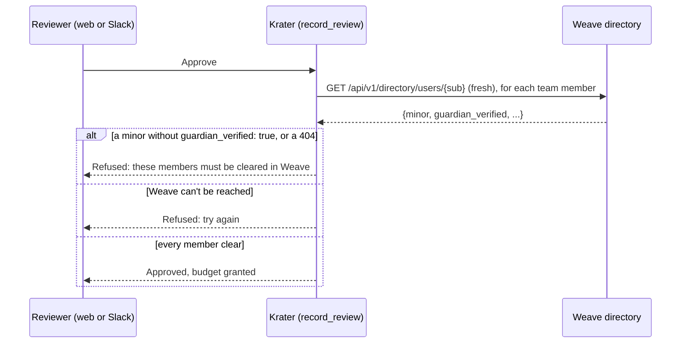

# Weave integration

Weave ([patchworklabsorg/weave](https://github.com/patchworklabsorg/weave)) is Patchwork Labs' identity provider: a
Rails app with Doorkeeper and `doorkeeper-openid_connect`, running at `https://weave.patchworklabs.org`. **Weave signs
people in and owns their Krater roles.** All Weave access goes through one adapter, `WeaveClient` (`krater/weave/`).

The maintainer decided this on 2026-10-07. It replaces the short-lived design where roles lived in Krater's database.
See [SPEC.md, Roles & authentication](SPEC.md#roles--authentication).

## What Krater needs from Weave

Krater depends on this Weave work. All of it is merged on Weave `main`:

- the stack patchworklabsorg/weave#156 to #161 (the `groups`, `roles` and `slack` claims);
- app-defined roles: [patchworklabsorg/weave#165](https://github.com/patchworklabsorg/weave/pull/165);
- the directory API: [patchworklabsorg/weave#166](https://github.com/patchworklabsorg/weave/pull/166).

The guardian gate also reads the directory fields `minor` and `guardian_verified`. Weave adds them now. Krater works
with a Weave that doesn't send them yet (see "Guardian verification" below).

A Weave superadmin must create the roles `member`, `reviewer` and `admin` on the Krater app page. An admin must add `directory` to the Krater app's scopes.

| Capability | Used for |
| --- | --- |
| OIDC Authorization Code + PKCE (PKCE is **required**) | Sign-in |
| Discovery, JWKS, RS256 id_tokens | Verifying the id_token |
| Claim `sub` | The user row. `sub` is the user's `p_id` (Patchwork ID), e.g. `PWL5A1B2C3D4` |
| Claims `name`, `email` | The signed-in name in the session cookie; never stored (see "Member data" below) |
| Claim `roles` (scope `roles`) | Krater's app-defined role keys the user holds |
| Claim `groups` (scope `groups`) | Group slugs linked to the Krater app; the fallback when `roles` is absent |
| Claims `slack_id`, `slack_member` (scope `slack`) | Mapping Slack clicks to users, and the Slack membership gate |
| The client_credentials grant, scope `directory` | Krater's own token for the directory API |
| `GET /api/v1/directory/users/{sub}` | The fresh role check before every action, the guardian gate before every budget grant, and names and emails when a page needs them |
| `GET /api/v1/directory/users?role=<key>` | "Everyone with role X", e.g. reviewers to invite to Slack channels, or finding a member by email |
| A second, public app for the `krater` CLI; `GET /oauth/token/info` and `GET /oauth/userinfo` with a member's CLI token | Checking the CLI's tokens (docs/compute/cli.md) |

Krater asks for the sign-in scopes `openid profile email groups roles slack`.

## Member data

Weave is the one place that stores member data (patchworklabsorg/internal-docs, "Member data" in `patches.md`).
Krater keeps only each member's Patchwork ID (`users.weave_sub`), plus Weave's `slack_id` and roles for routing Slack
clicks and for navigation. It stores no names, emails or other personal details:

- **Names and emails** are read from the directory when Krater needs them (`krater.services.people`), through the
  directory client's short in-memory cache. A page that can't reach Weave shows the Patchwork ID instead of failing.
- **Who did what** is recorded by Patchwork ID: audit events carry `actor_sub`, the worker's admin-override notice
  gets the admin's `sub` and reads their name when it posts, and a job's history says "a team member" or "an admin".
- **Finding a member** (inviting a teammate) takes a Patchwork ID, looked up directly, or an email,
  matched against `?role=member` because the directory has no search by email. Krater then stores the Patchwork ID.
- **Slack** uses Weave's `slack_id` only. Krater never looks Slack accounts up by email.
- **The signed-in name** shown in the header comes from the id_token and lives in the signed session cookie only.

When a member asks for their data to be deleted, Krater holds nothing to delete beyond their Patchwork ID and the
content they wrote (proposals, reviews), which belongs to their projects.

## Setting up Weave for Krater

1. Register Krater as a **confidential** OAuth app at `/admin/oauth_applications`.
2. Set the redirect URI to `https://<krater-host>/auth/callback`. Add `http://localhost:<port>/auth/callback` for
   development.
3. Give the app the scopes `openid profile email groups roles slack directory`. An admin must add `directory` to the
   Krater app's scopes, or the directory API answers 403.
4. On the Krater app page, a Weave superadmin creates the roles `member`, `reviewer` and `admin`.
5. Give people those roles in Weave. Everyone who uses Krater needs `member`.
6. Optional: link the groups `ganymede-members`, `krater-reviewers` and `krater-admins` to the Krater app. Krater only
   reads them when Weave sends no `roles` field at all.
7. Put the app's client id and secret in `KRATER_WEAVE_CLIENT_ID` and `KRATER_WEAVE_CLIENT_SECRET`. Krater uses the
   same pair for sign-in and for its directory token. No separate service key is needed.

## Roles

Weave sends the role keys a user holds for Krater in the `roles` claim and in each directory record. **`roles` is the
source of truth.** `krater.weave.roles.RoleMapping` translates them to Krater's internal names:

| Weave role key (setting) | Group slug fallback (setting) | Krater role |
| --- | --- | --- |
| `member` (`KRATER_WEAVE_ROLE_MEMBER`) | `ganymede-members` (`KRATER_WEAVE_GROUP_MEMBER`) | `ganymede:member` |
| `reviewer` (`KRATER_WEAVE_ROLE_REVIEWER`) | `krater-reviewers` (`KRATER_WEAVE_GROUP_REVIEWER`) | `ganymede:reviewer` |
| `admin` (`KRATER_WEAVE_ROLE_ADMIN`) | `krater-admins` (`KRATER_WEAVE_GROUP_ADMIN`) | `ganymede:admin` |

Rules:

- `roles: []` means "no roles". Krater does not fall back to groups for an empty list.
- Krater uses the group slugs only when the `roles` field is absent. Weave leaves it out when the token has no `roles`
  scope. Weave's `groups` also include groups linked through a role assignment.
- A `roles` value that isn't a list counts as no roles, so a malformed answer fails closed. Unknown keys are ignored.
- The internal names (`ganymede:*`) stay inside Krater. The `Actor`, approval policies and review snapshots use them.
  Nothing outside `krater.weave` sees Weave's keys or slugs.

## The directory API

Krater calls the directory with an access token of its own OAuth app:

- `POST {issuer}/oauth/token` with `grant_type=client_credentials` and `scope=directory`. The client id and secret go
  in HTTP Basic auth, not in the form body.
- Krater caches the token until 30 seconds before `expires_in`. On a 401 it fetches a new token and retries once.
- A 403 means a user token, a token without the `directory` scope, or an app that may not use the directory. It is a
  configuration error. Krater logs it, does not refetch, and fails closed.
- The API base is `KRATER_WEAVE_API_BASE_URL`. Leave it blank to use `KRATER_WEAVE_ISSUER`.

Endpoints:

- `GET /api/v1/directory/users/{sub}` answers
  `{sub, name, email, email_verified, slack_id, slack_member, groups, roles, active, minor, guardian_verified}`. A 404
  means the user is unknown or may not use Krater: Krater treats them as not a member. Only `active: true` counts as
  active. `minor` and `guardian_verified` are booleans that older Weave versions leave out. Krater reads a value
  that isn't a boolean as missing.
- `GET /api/v1/directory/users?role=<key>` (or `?group=<slug>`, which Krater doesn't use) answers
  `{"users": [...]}`, sorted by `sub`. Send exactly one parameter. A role or group that isn't linked to Krater answers
  404: Krater treats it as an empty list and logs a warning.

`get_user` answers are cached for 60 seconds for page views only: every state-changing action (`fresh_actor` on
anything but a GET/HEAD, and Slack clicks) asks with `fresh=True`, which skips the cache. Any other failure (no answer, a 5xx, malformed JSON) raises
`WeaveUnavailableError`, and the caller fails closed.

## Krater-side contract

### `WeaveClient` interface

```python
class WeaveClient(Protocol):
    def authorization_url(self, *, state: str, nonce: str, code_verifier: str, redirect_uri: str) -> str: ...
    def exchange_code(self, *, code: str, code_verifier: str, redirect_uri: str, nonce: str) -> WeaveIdentity: ...
    def get_user(self, sub: str) -> WeaveUser | None: ...  # None on 404
    def list_users_with_role(self, role: str) -> list[WeaveUser]: ...  # role is a Krater name
```

`WeaveIdentity` (from the id_token) and `WeaveUser` (from the directory) carry `sub`, `name`, `email`,
`email_verified`, `slack_id`, `slack_member` (`None` when Weave didn't say) and `roles` (Krater names). `WeaveUser` also
carries `active`, `minor` and `guardian_verified` (each `None` when Weave didn't say). `exchange_code` verifies the id_token against Weave's JWKS (signature, `iss`, `aud`, `exp`, `nonce`).

### Sign-in (`krater.services.users.sign_in`)

1. Upsert the `User` by `weave_sub`: `roles_cached`, and `slack_user_id` when Weave sent a `slack_id`. If another
   user row still holds that Slack id, it loses it. The name goes into the session cookie, not the database.
2. Without `ganymede:member`, refuse with the "not a member" page.

### Authorization (`krater.services.users.authorize`)

Every state-changing action asks Weave again by `sub`:

- web actions through `krater.web.deps.fresh_actor` (403 when refused, 503 when Weave is down);
- Slack Approve/Reject clicks through `krater.services.slack_reviews`. The Slack user id only finds the Krater user row
  (`users.slack_user_id`). Krater then re-checks that user by `sub`. There is no lookup by Slack id in Weave. An
  unknown Slack id gets "not linked".

A 404, `active: false` or a missing `member` role refuses the action. The record also refreshes the user's cached
roles and Slack id; its name and email ride on the `Actor` for that request only. `roles_cached` is for display and
navigation only.

### Slack membership gate

The gate prefers Weave's `slack_member` from the fresh directory record. When Weave doesn't say, Krater asks Slack
(see [SPEC.md](SPEC.md#roles--authentication)).

### Guardian verification

Weave owns the guardian check for members under 18. A Weave admin records a signed guardian form plus a call or
video check on the member's Weave admin page. Weave's directory then sends `guardian_verified: true`. Krater stores
no copy.

Before every budget grant, `krater.services.guardian.require_team_cleared` asks the directory by `sub`, with
`fresh=True`, for each team member (the lead and accepted members; and anyone joining a funded project, when they accept):

| Directory record | Krater's answer |
| --- | --- |
| `minor: true`, `guardian_verified: true` | Clear |
| `minor: true`, `guardian_verified` false or missing | Blocks the grant, and the member is named in the error |
| `minor: false` | Clear |
| No record (404) | Blocks the grant, and the member is named as "not available in Weave (no access to Krater)" |
| A record without `minor` | Not known to be a minor: clear, with a warning in the log |
| Weave can't be reached | The grant fails ("try again") |

A 404 blocks because Weave's directory hides anyone the Krater app may not serve, a minor whose guardian consent
is missing or was revoked included. Krater treats a record without `minor` as "not known to be a minor" because
Weave ships the field first. When every
deployment's Weave sends it, the warning in the log should stop. If it doesn't, check the Weave version.



The project page uses the same lookup (from the short cache) to show which members block a grant, and why. If
Weave can't answer, the page says so and still loads.

### Disabling someone

Do it in Weave: remove their Krater roles or their access to the Krater app, and revoke their tokens. The next action
they take in Krater is refused straight away: actions never use the directory cache. Pages they already have open
can keep showing what they could see for up to 60 seconds. Their boxes keep their SSH keys until the box stops; an
admin can cancel them from the project's Compute page.

## Stub mode

`KRATER_WEAVE_MODE=stub` (refused in production) replaces Weave with `krater/weave/stub_users.json`. Each fixture
user has the fields a real Weave sends: `sub`, `name`, `email`, `email_verified`, `slack_id`, optional
`slack_member`, `groups` (slugs), `roles` (keys) and optional `minor` and `guardian_verified`. One user
(`PWLREVIEWERTWO`) has no `roles` field, to exercise the group fallback. `PWLMINORONE` is a minor without a verified
guardian, `PWLMINORVERIFIED` is a minor with one, and `PWLMEMBERTWO` has no `minor` field. The stub client answers the
directory lookups from the same fixture with the same `RoleMapping`.

Tests change what Weave says mid-test with `StubWeaveClient.set_roles`, `set_active`, `set_minor`,
`set_guardian_verified`, `remove_user` and `put_user`. The
`weave_stub` fixture in `tests/conftest.py` is the stub the test app uses.
